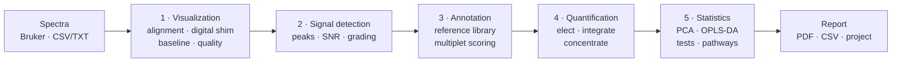

<p align="center">
  
</p>

<h1 align="center">NMRPro-H</h1>

<p align="center">
  <b>A transparent, auditable pipeline for 1D <sup>1</sup>H NMR metabolomics</b><br>
  signal detection · annotation · quantification · statistics · reporting
</p>

<p align="center">
  
  
  
  
  <a href="https://github.com/PatricioMR/nMRPro-H---1D-Metabolomics-Platform/releases/latest"></a>
</p>

<p align="center">
  <a href="#overview">Overview</a> ·
  <a href="#pipeline">Pipeline</a> ·
  <a href="#methods">Methods</a> ·
  <a href="#validation">Validation</a> ·
  <a href="#installation">Installation</a> ·
  <a href="#references">References</a>
</p>

---

## Overview

NMRPro-H is a desktop application for the analysis of one-dimensional
<sup>1</sup>H NMR spectra of biofluids and of tissue or cell extracts, with a
separate lipidomics module. It takes a set of spectra from the spectrometer and
returns identified metabolites, their concentrations in every sample, the
between-group statistics, and a PDF report that states how far each number can
be trusted.

Its design rests on one rule: **the software must read a spectrum the way an
analyst does, and must say what it did.** Every decision (which peak belongs to
which metabolite, which signal is integrated, what is reported when nothing is
found) is made once, by a function that can be read on its own, and is recorded
with the result.

**What distinguishes it**

- **Identification uses the multiplet, not only the chemical shift.** Candidates
  are judged on position, on the measured coupling constant against the
  coupling *measured from the reference compound's own spectrum*, and on the
  fit of the full multiplet shape.
- **Reference data are verified, not just imported.** Each reference signal was
  re-measured in the deposited BioMagResBank spectra, with an uncertainty.
- **Confidence is explicit.** Every reported metabolite carries a three-level
  mark (●●● / ●● / ●) built from the weaker of two independent kinds of evidence
  (what it *is* and how well it can be *measured*), and the PDF prints what each
  level was measured to mean.
- **Non-detections are never fabricated.** A metabolite that is not seen is
  `NaN`, with an upper bound from the method's detection limit; it is never
  interpolated or imputed.
- **Every transformation is reversible or on the record** (baseline, alignment,
  normalisation, manual region edits).
- **The validation is built in** and measured on simulated spectra whose
  composition is known (see [Validation](#validation)).

> **Status: Alpha.** The shipped pipeline (stages 1–5 below) is the one that was
> validated end to end. Overlap deconvolution (JG-Deconv, full-spectrum MCR) is
> implemented and tested but switched off (`DECONVOLUTION_ENABLED` in
> [`app_paths.py`](app_paths.py)) until it has its own validation. The balance of
> shared windows used by quantification is a default of its own
> (`QUANTIFICATION['split_shared']`, on).

---

## Pipeline



| # | Stage | What it does |
|---|---|---|
| 1 | **Visualization** | Import, groups and samples, blank (BLK) identification, reference alignment, Digital Shim, baseline correction, per-sample spectral quality |
| 2 | **Signal detection** | Peak picking foot-to-foot, SNR against the noise of the mean trace, Good / Average / Poor grading of every signal, manual region editing with undo |
| 3 | **Annotation** | Candidate search in a BMRB-derived reference library, hierarchical scoring on δ / multiplicity / J, multiplet shape fit, confidence marks |
| 4 | **Quantification** | Election of the signal that quantifies each metabolite, integration, joint fit of overlapping analytes, concentration against an internal standard, detection limits |
| 5 | **Statistics** | Two-group tests, PCA with PERMANOVA, PLS-DA and OPLS-DA, outliers, correlation, STOCSY, pathway over-representation, PDF/CSV export |

Secondary modules: lipidomics (library integration, D<sub>2</sub>O and CDCl<sub>3</sub>)
and 2D COSY cross-peak annotation.

---

## Methods

Each subsection says what is done, where the code lives, and which published
method it follows. Citations are kept in the docstring of the module that uses
them; the full list is in [References](#references).

### 1. Preprocessing

| Step | Method | Code |
|---|---|---|
| Import | Bruker processed data (`1r`, `procs`, `acqus`) at any folder depth; CSV/TXT | [`data/bruker_loader.py`](data/bruker_loader.py), [`data/loader.py`](data/loader.py) |
| Alignment | Global integer shift that brings the reference singlet (DSS / TSP / TMSP) of the blank samples to 0 ppm, applied to every sample. Deterministic, reversible, no peak distortion and no inter-segment discontinuities | [`processing/peak_alignment.py`](processing/peak_alignment.py) |
| Per-signal alignment | Optional: the spectrum is cut at the valleys of the envelope of all samples and each segment is aligned on its own (icoshift intervals; Savorani 2010), so signals that move differently from sample to sample — pH, ionic strength — are aligned without splitting a peak. The record of every shift is kept | [`processing/peak_alignment.py`](processing/peak_alignment.py) |
| Region alignment | Shift of a chosen region, kept as an edit that can be reverted and is recorded; vacated edges are not zero-filled | [`gui/widgets/region_alignment_window.py`](gui/widgets/region_alignment_window.py) |
| Digital Shim | Reference deconvolution (FIDDLE): the time-domain signal of the whole spectrum is divided by that of a clean reference line and multiplied by an ideal line shape, with Wiener regularisation. Integrated areas are conserved. Morris 1988; Gibbs & Morris 1991; Morris, Barjat & Horne 1997 | [`processing/digital_shim.py`](processing/digital_shim.py) |
| Baseline | arPLS (Baek 2015), SNIP (Ryan 1988) or rolling ball. Off by default; the integration step reads a local baseline from where the cluster of signals ends, not from the window's feet | [`processing/baseline_correction.py`](processing/baseline_correction.py), [`processing/baseline_model.py`](processing/baseline_model.py) |
| Spectral quality | FWHM and asymmetry of the reference signal, per sample, graded in Hz at the measured field | [`processing/spectral_quality.py`](processing/spectral_quality.py) |
| Excluded regions | The presaturated water region (4.50–5.00 ppm by default, a project setting) is excluded before anything is measured: the suppression leaves a broad artefact that library signals can match and be quantified as an analyte (Beckonert 2007) | [`processing/spectral_regions.py`](processing/spectral_regions.py) |

### 2. Signal detection

- Peaks are separated by their valley points (foot–head–foot) after optional
  baseline correction (automatic baseline after Cobas et al. 2006).
- **Noise** is estimated on the segment of lowest variance of the *mean*
  trace, with the same estimator everywhere, because every downstream gate
  (detection limits, "would I see it if it were here", cascade ceilings) reads
  the mean trace.
- **Area, height and SNR have one definition** (area above the foot line), shared
  by detection, the signal viewer and any re-measure after a manual boundary
  change.
- Every signal is graded **Good / Average / Poor** from line-shape fidelity,
  symmetry (even/odd decomposition about the apex), baseline horizontality and
  grounding, hidden shoulders and line-width anomaly. Two hard gates send a
  signal straight to Poor: SNR at or below the detection limit, and too few
  points across the FWHM for the integral to mean anything.
- Isolated apexes of the mean trace at ≥ 10 σ that detection missed are added.

Code: [`processing/peak_detection.py`](processing/peak_detection.py),
[`processing/noise_estimation.py`](processing/noise_estimation.py),
[`processing/signal_quality.py`](processing/signal_quality.py).

### 3. Annotation

**Reference library.** SQLite libraries derived from the BioMagResBank
(Ulrich 2008; Hoch 2023), 304 to 480 metabolites depending on the library
(v05). They are read-only at runtime. Reference values were not taken from the
peak lists as published (rounded to three decimals, which at 500 MHz is half a
hertz): each line was **re-measured in the deposited reference spectra** — where
it peaks, the coupling from the line spacing, the width and SNR — and a value is
kept only when at least two depositions agree, the one the earlier library value
was read from among them. Proton counts follow the molecule's stoichiometry (v05 corrects 22 of
them, each with its previous value and the reason). Position uncertainty follows
FWHM/SNR (Posener 1974).
Code: [`processing/reference_measurement.py`](processing/reference_measurement.py),
[`hmdb_api_download/`](hmdb_api_download/).

**Predicted pattern.** For each library signal the expected lines are built
from the measured line positions or, failing that, from the multiplicity,
`J` and proton count (Pascal coefficients, spacing `J(Hz) / spectrometer(MHz)`).
The spectrometer frequency is the one the analyst sets; there is no hidden
default.

**Hierarchical scoring** ([`processing/annotation_scoring.py`](processing/annotation_scoring.py)).
The model mirrors how a spectrum is read by hand:

1. a Δδ window decides which peaks are candidates for a signal;
2. multiplicity and ΔJ decide whether the candidate *is* that signal — J is
   preferred over δ because it is more stable against pH and temperature
   (Dona 2016; Wermter, Bock & Dreher 2026);
3. an expected-height check removes a peak that is too small to be the
   signal its metabolite's other signals say it must be (overlap makes a peak
   taller, never shorter);
4. a lone singlet carries no coupling evidence and is capped below the Good
   band.

**Multiplet as a shape.** A complex multiplet (e.g. the 14 ribose lines of NAD)
is not judged line by line but by the reference's own profile, broadened to the
study's line width. The largest copy of the shape that fits *under* the measured
trace is taken, because other analytes add intensity and never remove it; the
fit is judged on its apexes, by SNR and by the fraction of the region it
explains. For compounds with a GISSMO spin system, the pattern of every
complex multiplet (`m`, `m*`) is **solved at the study's own field** instead of
taken from a reference spectrum recorded at another one: second-order patterns
change shape with the field, and a quarter of the stored ones correlated below
0.76 with their own spin system at 600 MHz (Dashti 2017). A complex multiplet
confirmed on at least two good lines competes for its peak, at one dot.
Code: [`processing/pattern_shape.py`](processing/pattern_shape.py),
[`processing/spin_patterns.py`](processing/spin_patterns.py).

**Cascade for what the election missed.** A metabolite spread thin over several
signals can lose every one of them to a neighbour. The cascade builds one column
per metabolite (the sum of the shapes of all its listed signals, scaled to their
proton counts, at the listed positions plus the study's drift) and selects
metabolites by forward selection with a non-negative refit (orthogonal matching
pursuit + NNLS). One amplitude per metabolite couples all its signals, so the
reference's relative intensities act as a constraint rather than a line count.
A metabolite the cascade takes in is reported only when a logistic model over
what the cascade measured (apex SNR, agreement between its own signals, share of
its listing left free, slide) scores it at 0.2 or more; below, it is listed as a
candidate without a number.
Code: [`processing/quant_cascade.py`](processing/quant_cascade.py).
This follows the simultaneous-template fitting of BATMAN (Hao 2012), Bayesil
(Ravanbakhsh 2015), ASICS (Tardivel 2017) and COLMAR1d.

**Confidence marks.** Each reported metabolite gets

```
confidence = min(identity, shape, quantity)
```

- *identity* — at least one confirmed signal and nothing missing from its
  listing at the measured amount (3); no signal confirmed but at least 75% of the listing matched (2); the
  rest (1);
- *shape* — complete multiplet with ΔJ ≤ 0.20 Hz (3), complete multiplet (2),
  otherwise (1);
- *quantity* — area ≥ 3 × LOQ (3), otherwise (2, never lower: a small amount
  says the number is imprecise, not that the assignment is wrong).

**Position.** A metabolite whose quantified signal stands further from the
study's common drift than 4.5 × the lower quartile of the confirmed signals'
own distance is held at ●: most likely the peak is another compound's. A
**singlet** in that state is withdrawn instead: position is the only evidence a
singlet has, and it failed.

The levels follow the reporting tiers of the Metabolomics Standards Initiative
(Sumner 2007). The precision each level was *measured* to have is printed in the
PDF ([Validation](#validation)).

### 4. Quantification

Three decisions, each made once and on its own, in the order *elect → integrate
→ concentrate* ([`processing/quant_engine.py`](processing/quant_engine.py)):

| Decision | Question | Code |
|---|---|---|
| **Elect** | Which signal quantifies which metabolite, and why did the others get nothing? One function over plain data, ranked by the same key the Annotation window shows, so what the analyst sees is what is quantified | [`processing/quantification.py`](processing/quantification.py) |
| **Integrate** | What is the area of that multiplet in each sample, on its own? Each line is integrated foot to foot and never past a foreign detected peak; the resolved part of the multiplet is scaled by the intensity pattern its multiplicity dictates, computed from the Lorentzian line shape (qHNMR practice: Bharti & Roy 2012; Pauli 2012) | [`processing/quant_integration.py`](processing/quant_integration.py) |
| **Concentrate** | Area per proton, against the internal standard, in mM, times dilution | [`processing/quant_concentration.py`](processing/quant_concentration.py) |

**Overlapping analytes** are not read from a window that contains a neighbour's
area. Metabolites whose shapes overlap are **fitted together, sample by sample**
(non-negative sum of their shapes plus free Lorentzian components at every
detected peak no quantified analyte accounts for — the "unknown" term the
published methods all carry). A fit that holds a shape against the limit of its
allowed shift, or fits a different signal from the elected one, is refused
(`FIT_MISPLACED`) instead of reported. Each signal of an analyte may settle up
to two line widths from where the reference lists it: in an extract every
environment moves on its own with pH and ionic strength.
Code: [`processing/quant_joint_fit.py`](processing/quant_joint_fit.py),
[`processing/quant_shared.py`](processing/quant_shared.py).

**Detection and quantification limits** follow the analytical convention
(Currie 1968; IUPAC, Currie 1995; qNMR convention of Bharti & Roy 2012): LOD at
3 σ and LOQ at 10 σ of the **blank**, a property of the method and not of which
neighbours an analyte happens to have. Interference from neighbours is reported
separately, as a loss of accuracy rather than of detectability.
Code: [`processing/quant_detection_limit.py`](processing/quant_detection_limit.py).

**Non-detects.** "No detected peak" is reported as "below what this experiment
can see here", an upper bound, never as a substituted value
(Helsel 2006). In the exports and in every statistic a non-detect is `NaN`.

**Normalisation.** Internal standard (DSS/TSP) and, optionally, **PQN**
(Dieterle 2006) on the median of the per-analyte quotients. PQN removes any
difference that reaches every metabolite alike, so a real global change between
groups is read as dilution: the application states this and **warns when the
groups' mean PQN factors diverge by more than 1.20×**, in the interface and in the
report. Concentrations after PQN are relative composition.

### 5. Statistics

| Analysis | Method | Code |
|---|---|---|
| Two-group tests | Welch's *t* (unequal variances) and Mann–Whitney *U*; the analyst chooses, nothing is substituted silently, `NaN` when a test is undefined | [`processing/group_stats.py`](processing/group_stats.py) |
| PCA | Scores, explained variance, **PERMANOVA** (pseudo-F, R², p; Euclidean in the full space, 999 permutations; Anderson 2001) printed on the plot and in the CSV | [`processing/multivariate.py`](processing/multivariate.py) |
| PLS-DA | Cross-validated Q², permutation test, VIP | [`processing/multivariate.py`](processing/multivariate.py) |
| OPLS-DA | Predictive / orthogonal split (Trygg & Wold 2002) | [`processing/multivariate.py`](processing/multivariate.py) |
| Outliers | Generalised ESD (Rosner 1983), robust to masking; Grubbs (1969) | [`processing/outlier_detection.py`](processing/outlier_detection.py) |
| Correlation | Spearman rank correlation; STOCSY (Cloarec 2005) | [`processing/correlation.py`](processing/correlation.py), [`processing/stocsy.py`](processing/stocsy.py) |
| Pathways | Over-representation analysis (Fisher's exact test, enrichment ratio, Benjamini–Hochberg FDR) over local pathway membership | [`processing/pathway_enrichment.py`](processing/pathway_enrichment.py) |

### 6. Lipidomics and COSY

- **Lipidomics** is deliberately simple: trapezoidal integration of the regions
  defined in a cited library, with no peak detection or fitting. D<sub>2</sub>O
  uses the SigMa library (Khakimov 2020, relative quantification only);
  CDCl<sub>3</sub> uses the library of Li 2017.
- **COSY** cross-peaks are annotated by co-occurrence of shifts, with no 2D
  database (Bingol & Brüschweiler 2014; Robinette 2008), ranked by the fraction
  of observed cross-peaks a metabolite explains, with J-confirmation.

### 7. Reporting and reproducibility

- **PDF report** with the parameters used, the figure that produced each number
  (the fitted shape or the real window and baseline, not a re-drawing), the PQN
  notice, and the validation page for the field strength of the project.
- **Projects** (`.nmrproj`) store every parameter variable of every stage by
  name (not from a hand-kept list), the options of the last run and the engine
  version; the application reports what could not be restored and when the
  current options differ from those that produced the results. Saving is atomic
  with a `.bak`, and auto-saves every five minutes.
- The δ axis is always inverted and units are on every plot; parsing, alignment
  and detection problems are surfaced to the user, never swallowed.

---

## Validation

Identification and quantification are validated on **simulated spectra of known
composition**, solved from experimentally fitted spin systems.

- **Spectra:** the spin Hamiltonian of each compound (δ and J from the GISSMO
  library, Dashti 2017) is solved exactly at the chosen field, 169 compounds,
  Lorentzian lines of 2.6 Hz. Mixtures are linear sums at 0.05–1 mM, with DSS
  0.5 mM as internal standard, lactate doublet at SNR 500, 12 samples in two
  groups, per-sample drift.
- **Tubes:** 18, 50 and 100 analytes (a biological extract holds 100 or more),
  3 random draws each, at 500 and 600 MHz.
- **What is measured:** whether each reported metabolite is in the tube
  (precision per confidence level), how many of the tube's metabolites are
  identified at all (found) and at ●● or better (recall), how many reported
  metabolites are not in the tube (false per run, all levels), and the error of
  the reported concentration against the true one.

Software v0.7, database `BMRB_Metabolomics_Mammalian_v05`, 3 seeds per row
([`data/quality_reference.json`](data/quality_reference.json)):

| Field | Tube | Peaks detected | Found | Recall ≥ ●● | ●●● precision (real / false) | ●● precision | ● precision | False per run | Median error | P90 error |
|---|---|---|---|---|---|---|---|---|---|---|
| 500 MHz | 18 | 87 | 94% | 83% | 100% (16 / 0) | 97% | 30% | 5.0 | 10% | 31% |
| 500 MHz | 50 | 189 | 82% | 63% | 100% (39 / 0) | 92% | 40% | 16.0 | 13% | 52% |
| 500 MHz | 100 | 282 | 76% | 59% | 93% (38 / 3) | 85% | 51% | 25.0 | 21% | 83% |
| 600 MHz | 18 | 97 | 94% | 81% | 100% (18 / 0) | 100% | 35% | 4.3 | 7% | 25% |
| 600 MHz | 50 | 205 | 89% | 63% | 100% (39 / 0) | 95% | 48% | 15.0 | 11% | 46% |
| 600 MHz | 100 | 301 | 78% | 60% | 96% (44 / 2) | 90% | 49% | 23.7 | 18% | 92% |

The PDF prints the row whose peak count is closest to the project's own, and
says so when the project is denser than the densest tube.

**Limits of the validation, stated plainly**

- The simulated spectra are idealised: pure Lorentzians, no baseline, water
  signal or macromolecules, and δ/J are shared with the reference library (only
  the line shape is independent). Pre-GISSMO benches, which generated spectra
  from the very profiles the annotation searches for, were optimistic and have
  been retired as the source of the published numbers.
- Concentrations follow the bench design (0.05–1 mM), not a specific biofluid.
- Error grows when a metabolite is small and its neighbours are large, because
  their tails sit inside its window; the table's P90 reflects that.
- PQN was validated in a 12-sample, 18-analyte bench (factor recovered to
  2–3%; within-group CV of unchanged metabolites 36% → 11% under 30% dilution
  variation); the 50- and 100-analyte case was not measured.

The benches are in [`validation/`](validation/) (`gissmo_bench`, `quality_reference`,
`pqn_bench`, `crowded_bench`, `mixture_bench`) and can be re-run.

---

## Installation

### Windows installer (recommended)

Download `NMRPro-H-Setup.exe` from the
[latest release](https://github.com/PatricioMR/nMRPro-H---1D-Metabolomics-Platform/releases/latest)
and run it. Databases the analyst edits live in `%APPDATA%\NMRPro-H`, so the
install folder stays read-only.

### From source

```bash
git clone https://github.com/PatricioMR/nMRPro-H---1D-Metabolomics-Platform.git
cd nMRPro-H---1D-Metabolomics-Platform
pip install -r requirements.txt
python main.py
```

Python 3.11 or newer (developed and tested on 3.14). `tkinter` and `sqlite3`
ship with CPython. Dependencies: numpy, scipy, scikit-learn, matplotlib, pandas,
networkx, reportlab, pillow, requests.

### Build the installer

```bat
build_windows.bat
```

PyInstaller (`nmrpro_h.spec`) followed by Inno Setup (`installer/nmrpro_h.iss`)
→ `Output/NMRPro-H-Setup.exe`. The version has a single source,
`__version__` in [`app_paths.py`](app_paths.py).

---

## Quick start

1. **Visualization** — open a folder of Bruker spectra, define groups and
   samples, mark blanks, align to the reference signal, inspect spectral quality.
2. **Signal detection** — detect, review the Good / Average / Poor grading, edit
   a region if needed.
3. **Annotation** — choose the reference library, set the spectrometer
   frequency, run, review candidates and confidence marks.
4. **Quantification** — choose the internal standard (and PQN if the study
   warrants it), run; read concentrations with their limits and confidence.
   From here on the Signal List names each signal after the metabolite that was
   quantified on it.
5. **Statistics** — choose groups and test, view PCA/PLS-DA/OPLS-DA, export CSV
   and the PDF report.

---

## Repository layout

```
main.py            entry point
app_paths.py       version (single source), resource paths, feature switches
gui/               Tkinter interface
  stages/          visualization · peak_detection · annotation · quantification ·
                   statistics (+ parked: j_resolve, fullspectrum_mcr; COSY)
  widgets/         signal list, region alignment, annotation results, PDF report…
processing/        signal processing and scientific logic (no GUI imports)
data/              loaders, library access, quality reference
controllers/       orchestration and analysis defaults
databases/         BMRB-derived SQLite libraries (read-only at runtime)
validation/        simulated-spectra benches and reference-table generator
hmdb_api_download/ reference-library build and verification scripts
installer/         Inno Setup script
tests/             unit · integration · smoke (pytest)
```

Architecture rules: no signal-processing logic in controllers or plotting;
SQL is always parameterised; schemas change only by explicit migration.

---

## Tests

```bash
pytest tests/unit
pytest tests/integration     # real test database, not mocked
pytest tests/smoke
```

Every method in `processing/` has unit tests; complete pipelines
(load → process → annotate → quantify → export) and project save/load
round-trips have integration tests.

---

## References

**Spectral processing**
- Morris GA. Compensation of instrumental imperfections by deconvolution using an internal reference signal. *J Magn Reson* 1988;80:547.
- Gibbs A, Morris GA. Reference deconvolution. Elimination of distortions arising from reference line truncation. *J Magn Reson* 1991;91:77.
- Morris GA, Barjat H, Horne TJ. Reference deconvolution methods. *Prog NMR Spectrosc* 1997;31:197.
- Baek S-J, Park A, Ahn Y-J, Choo J. Baseline correction using asymmetrically reweighted penalized least squares smoothing. *Analyst* 2015;140:250–257.
- Ryan CG, Clayton E, Griffin WL, Sie SH, Cousens DR. SNIP, a statistics-sensitive background treatment for the quantitative analysis of PIXE spectra. *Nucl Instrum Methods B* 1988;34:396–402.
- Cobas JC, Bernstein MA, Martín-Pastor M, Tahoces PG. A new general-purpose fully automatic baseline-correction procedure for 1D and 2D NMR data. *J Magn Reson* 2006;183:145–151.
- Posener DW. Precision in measuring resonance spectra. *J Magn Reson* 1974;14:121.
- Savorani F, Tomasi G, Engelsen SB. icoshift: a versatile tool for the rapid alignment of 1D NMR spectra. *J Magn Reson* 2010;202:190–202.

**Identification and quantification**
- Sumner LW et al. Proposed minimum reporting standards for chemical analysis (MSI). *Metabolomics* 2007;3:211–221.
- Dona AC et al. A guide to the identification of metabolites in NMR-based metabonomics/metabolomics experiments. *Comput Struct Biotechnol J* 2016;14:135–153.
- Wermter F, Bock C, Dreher W. 1H NMR chemical shifts and J-coupling constants dependence on temperature and pH. *NMR Biomed* 2026. doi:10.1002/nbm.70239
- Hao J, Astle W, De Iorio M, Ebbels TMD. BATMAN — an R package for the automated quantification of metabolites from NMR spectra using a Bayesian model. *Bioinformatics* 2012;28:2088–2090.
- Ravanbakhsh S et al. Accurate, fully-automated NMR spectral profiling for metabolomics (Bayesil). *PLoS One* 2015;10:e0124219.
- Tardivel P et al. ASICS: automatic identification and quantification of metabolites in complex 1D 1H NMR spectra. *Metabolomics* 2017;13:109.
- Canlet C et al. NMR metabolite quantification of a synthetic urine sample: an inter-laboratory comparison of processing workflows. *Metabolomics* 2023;19:65. doi:10.1007/s11306-023-02028-4
- Bharti SK, Roy R. Quantitative 1H NMR spectroscopy. *TrAC Trends Anal Chem* 2012;35:5–26.
- Pauli GF, Gödecke T, Jaki BU, Lankin DC. Quantitative 1H NMR. Development and potential of an analytical method: an update. *J Nat Prod* 2012;75:834.
- Currie LA. Limits for qualitative detection and quantitative determination. *Anal Chem* 1968;40:586–593.
- Currie LA. Nomenclature in evaluation of analytical methods including detection and quantification capabilities (IUPAC). *Pure Appl Chem* 1995;67:1699–1723.
- Helsel DR. Fabricating data: how substituting values for nondetects can ruin results, and what can be done about it. *Chemosphere* 2006;65:2434–2439.
- Dieterle F, Ross A, Schlotterbeck G, Senn H. Probabilistic quotient normalization as robust method to account for dilution of complex biological mixtures. *Anal Chem* 2006;78:4281–4290.

**Statistics**
- Welch BL. The generalization of "Student's" problem when several different population variances are involved. *Biometrika* 1947;34:28–35.
- Mann HB, Whitney DR. On a test of whether one of two random variables is stochastically larger than the other. *Ann Math Stat* 1947;18:50–60.
- Anderson MJ. A new method for non-parametric multivariate analysis of variance. *Austral Ecol* 2001;26:32–46. doi:10.1111/j.1442-9993.2001.01070.pp.x
- Trygg J, Wold S. Orthogonal projections to latent structures (O-PLS). *J Chemometrics* 2002;16:119–128. doi:10.1002/cem.695
- Grubbs FE. Procedures for detecting outlying observations in samples. *Technometrics* 1969;11:1–21.
- Rosner B. Percentage points for a generalized ESD many-outlier procedure. *Technometrics* 1983;25:165–172.
- Cloarec O et al. Statistical total correlation spectroscopy: an exploratory approach for latent biomarker identification from metabolic 1H NMR data sets. *Anal Chem* 2005;77:1282–1289.
- Spearman C. The proof and measurement of association between two things. *Am J Psychol* 1904;15:72–101.

**Data, simulation and lipidomics**
- Ulrich EL et al. BioMagResBank. *Nucleic Acids Res* 2008;36:D402–D408.
- Hoch JC et al. Biological Magnetic Resonance Data Bank. *Nucleic Acids Res* 2023;51:D368–D376.
- Dashti H, Westler WM, Tonelli M, Wedell JR, Markley JL, Eghbalnia HR. Spin system modeling of NMR spectra for applications in metabolomics and small molecule screening. *Anal Chem* 2017;89:12201–12208. doi:10.1021/acs.analchem.7b02884
- Muncey HJ, Jones R, De Iorio M, Ebbels TMD. MetAssimulo: simulation of realistic NMR metabolic profiles. *BMC Bioinformatics* 2010;11:496.
- Pople JA, Schneider WG, Bernstein HJ. *High-resolution Nuclear Magnetic Resonance*. McGraw-Hill, 1959.
- Khakimov B, Mobaraki N, Trimigno A, Aru V, Engelsen SB. Signature Mapping (SigMa): an efficient approach for processing complex human urine 1H NMR metabolomics data. *Anal Chim Acta* 2020;1108:142–151. doi:10.1016/j.aca.2020.02.025
- Li Q et al. Applications of nuclear magnetic resonance in lipid analyses. *Prog Lipid Res* 2017;68:37–56.
- Bingol K, Brüschweiler R. Multidimensional approaches to NMR-based metabolomics. *Anal Chem* 2014;86:47–57. Robinette SL et al. 2008 (principle of COSY annotation by shift co-occurrence).
- Tadaka S et al. *Nucleic Acids Res* 2018 (jMorp); Mandal R et al. *Anal Chem* 2024 (SRM 1950): sources of reference biofluid concentrations.
- Beckonert O et al. Metabolic profiling, metabonomic and metabolomic procedures for NMR spectroscopy of urine, plasma, serum and tissue extracts. *Nat Protoc* 2007;2:2692–2703.

The name NMRPro-H was chosen so as not to collide with NMRPipe
(Delaglio F et al. *J Biomol NMR* 1995;6:277–293), an unrelated package.

---

## Citation

A manuscript describing NMRPro-H is in preparation. Until it is published,
please cite the software and the release you used (for example
*NMRPro-H v0.7 Alpha*, tag `v0.7`).

## Acknowledgements

Reference spectra: BioMagResBank. Spin-system parameters: GISSMO. Both are
public resources of the NMR community and are cited above.
