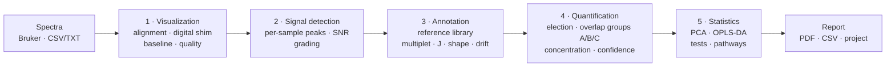

<p align="center">
  
</p>

<h1 align="center">NMRPro-H</h1>

<p align="center">
  <b>A transparent, auditable pipeline for 1D <sup>1</sup>H NMR metabolomics</b><br>
  spectral processing · metabolite identification · quantification · statistics · reporting
</p>

<p align="center">
  
  
  
  
  <a href="https://github.com/PatricioMR/nMRPro-H---1D-Metabolomics-Platform/releases/latest"></a>
</p>

<p align="center">
  <a href="#overview">Overview</a> ·
  <a href="#pipeline">Pipeline</a> ·
  <a href="#methods">Methods</a> ·
  <a href="#validation">Validation</a> ·
  <a href="#installation">Installation</a> ·
  <a href="#roadmap">Roadmap</a> ·
  <a href="#references">References</a>
</p>

---

## Overview

NMRPro-H is a desktop application for the analysis of one-dimensional
<sup>1</sup>H NMR spectra of biofluids and of tissue or cell extracts. It takes a
set of spectra from the spectrometer and returns the identified metabolites,
their concentration in every sample, the between-group statistics, and a PDF
report that states how far each number can be trusted.

Its design rests on one rule: **the software must read a spectrum the way an
analyst does, and must say what it did.** Every decision (which peak belongs to
which metabolite, how an overlap is resolved, what is reported when nothing is
found) is made by a function that can be read on its own, and is recorded with
the result.

**What distinguishes it**

- **Identification uses the multiplet, not only the chemical shift.** Candidates
  are judged on position, on the measured coupling constant against the coupling
  *measured from the reference compound's own spectrum*, on the line heights the
  multiplicity predicts, and on what the rest of the compound's signals say.
- **Reference data are verified, not just imported.** Each reference signal was
  re-measured in the deposited BioMagResBank spectra.
- **Overlap is resolved by shapes, in three groups the analyst controls**:
  windows resolved by the shapes of what sits in them, a joint fit of
  overlapping analytes, and a residual cascade for analytes the election missed.
- **Confidence is explicit.** Every reported metabolite carries ●●● / ●● / ●, the
  weakest of three independent judgements, and the PDF prints the precision each
  level was measured to have.
- **Non-detections are never fabricated.** A metabolite that is not seen has no
  number (`NaN`) and says why; nothing is interpolated or imputed.
- **Every transformation is reversible or on the record**, and the same input
  always gives the same result.
- **The validation is built in**: simulated spectra of known composition,
  exported run by run so every figure can be audited (see [Validation](#validation)).

> **Status: Beta (v0.8).** The pipeline below is the one validated end to end.
> MCR-based deconvolution stages are kept in the code, tested, and switched off
> (`DECONVOLUTION_ENABLED` in [`app_paths.py`](app_paths.py)) until they have
> their own validation.

---

## Pipeline



| # | Stage | What it does |
|---|---|---|
| 1 | **Visualization** | Import, groups and samples, blanks, reference alignment, digital shim, baseline model, per-sample spectral quality |
| 2 | **Signal detection** | Per-sample peak picking with group presence, SNR, Good / Average / Poor grading, manual split or add of a signal window |
| 3 | **Annotation** | Candidate search in a BMRB-derived library; line-by-line multiplet matching, ΔJ, spin-system shapes; study drift; quality verdict per signal |
| 4 | **Quantification** | Election of one analyte per peak; window integration; overlap groups A (windows by shapes), B (joint fit), C (residual cascade); controls; concentration against an internal standard; confidence dots |
| 5 | **Statistics** | Two-group tests, PCA with PERMANOVA, PLS-DA and OPLS-DA, outliers, correlation, STOCSY, pathway over-representation |

A lipidomics module (region integration with a cited library, D<sub>2</sub>O and
CDCl<sub>3</sub>) ships alongside.

---

## Methods

The subsections follow the order of the Methods of the manuscript. Each says
what is done, where the code lives and which published method it follows;
citations are kept in the docstring of the module that uses them.

### 1. Architecture and implementation

Python (≥ 3.11) desktop application with a Tkinter interface and embedded
matplotlib plots; numerical work in numpy/scipy; reference data in SQLite; PDF
reports with reportlab; distributed as a Windows installer (PyInstaller + Inno
Setup).

| Layer | Folder | Holds |
|---|---|---|
| Data access | [`data/`](data/) | Bruker and table loaders, library access, project file |
| Signal processing | [`processing/`](processing/) | baseline, noise, detection, alignment, annotation scoring, quantification, deconvolution, cascade, confidence (no GUI imports) |
| Orchestration | [`controllers/`](controllers/) | analysis defaults, annotation controller |
| Interface | [`gui/`](gui/) | one stage per workflow step, review windows, PDF report |
| Validation | [`validation/`](validation/) | simulated benches, ablation, exports |

- **One place for defaults:** every setting a new analysis starts with is in
  [`controllers/analysis_defaults.py`](controllers/analysis_defaults.py); the
  interface builds its controls from it and the validation replays it
  ([`validation/fresh_run.py`](validation/fresh_run.py)), so the benches measure
  exactly what a new user runs.
- **Projects (`.nmrproj`):** a zip with a JSON manifest, the analysis state and the
  spectra as float32; atomic save, background autosave every 5 minutes with
  recovery at start-up. Every analyst decision (marks, exclusions, accept/reject
  in the deconvolution review) is saved and restored.
- **Determinism:** the same input gives the same output; an integration test
  re-runs a whole analysis and compares.

### 2. Spectral visualization and editable processing

Every transformation is recomputed from the imported matrix, which is never
overwritten, so each can be previewed, undone and audited. The δ axis is always
inverted and units are shown on every plot.

| Step | Method | Default | Code |
|---|---|---|---|
| Import | Bruker processed data (`1r`, `procs`, `acqus`, field read from `procs`) or a ppm × samples table; sample editor for group, type (sample/blank), group dilution and per-sample correction factor | — | [`data/bruker_loader.py`](data/bruker_loader.py), [`data/loader.py`](data/loader.py) |
| Spectral quality | FWHM and asymmetry of the reference singlet per sample | reported | [`processing/spectral_quality.py`](processing/spectral_quality.py) |
| Digital shim | Reference deconvolution (FIDDLE), Wiener-regularised; areas conserved (Morris 1988; Gibbs & Morris 1991; Morris, Barjat & Horne 1997) | off | [`processing/digital_shim.py`](processing/digital_shim.py) |
| Baseline model | SNIP (Ryan 1988) or arPLS (Baek 2015); one project-wide decision applied before detection; quantification integrates the unmodelled data and every window says what the model would have removed | SNIP at detection | [`processing/baseline_model.py`](processing/baseline_model.py) |
| Alignment | to the reference singlet (global integer shift), rigid whole-spectrum shift to the most representative sample, or segment-wise with intervals chosen at the valleys (icoshift, Savorani 2010; recursive segments, Veselkov 2009) | rigid shift in detection | [`processing/peak_alignment.py`](processing/peak_alignment.py) |
| Excluded regions | presaturated water 4.50–5.00 ppm and any region the analyst adds (Beckonert 2007) | water | [`processing/spectral_regions.py`](processing/spectral_regions.py) |
| Noise | standard deviation in the signal-free 10–12 ppm region, or the quietest segment when the spectrum has none | 10–12 ppm | [`processing/noise_estimation.py`](processing/noise_estimation.py) |
| Signal edits | split a window at a valley or add one where detection found nothing; each edit labelled, measured with detection's own arithmetic, undoable | — | [`processing/signal_edit.py`](processing/signal_edit.py) |

### 3. Spectral deconvolution

Integration is kept where a signal stands alone. Where analytes overlap, the
trace is modelled as a non-negative sum of reference shapes, sample by sample
(Lawson & Hanson 1974). In the Quantification stage these methods are offered as
**three groups**, from local to global, all on by default:

| Group | Scale | What it does | Code |
|---|---|---|---|
| Base (always on) | one window | window integration, with the Lorentzian tail of each resolved neighbour computed from its measured area and subtracted | [`processing/quant_integration.py`](processing/quant_integration.py), [`processing/quant_deconvolution.py`](processing/quant_deconvolution.py) |
| **A · Resolve windows by shapes** | one window | the balance of a window two winners contest; a window holding another accepted analyte's signal divided by their shapes (the intruder bounded by twice its clean amount; the remainder reported, not assigned); complex multiplets (m*) identified and measured by their shape — the reference profile, or the GISSMO spin system solved at the study's field (Dashti 2017; Weljie 2006) | [`processing/quant_shared.py`](processing/quant_shared.py), [`processing/quant_shape.py`](processing/quant_shape.py), [`processing/pattern_shape.py`](processing/pattern_shape.py), [`processing/spin_patterns.py`](processing/spin_patterns.py) |
| **B · Joint fit** | a region of overlapping signals | the overlapping analytes fitted together, each as one column of all its listed signals (area per proton), with a free Lorentzian at every detected peak no quantified analyte explains; each signal may slide up to two linewidths; unreported candidates enter as columns; columns placed at the peak the election matched (BATMAN, Hao 2012; ASICS, Tardivel 2017; Canlet 2023; COLMAR1d) | [`processing/quant_joint_fit.py`](processing/quant_joint_fit.py) |
| **C · Residual cascade** | the whole residual | analytes the election never gave a peak, found by forward selection on what the quantified ones leave (orthogonal matching pursuit, Pati 1993) with a joint non-negative refit; each signal caps the amplitude at what the trace holds; reported with a concentration when a logistic score over 12 features reaches 0.2 (0.4 after the 60th entry), at two dots at most | [`processing/quant_cascade.py`](processing/quant_cascade.py) |

**Review.** A deconvolution window lists every row that was split, fitted jointly
or found by the cascade, and every identification left without a number, with
the fitted curves over the trace. The analyst can reject a row, or accept it:
acceptance changes only the accepted analyte (the study is quantified once
without the acceptances, for every other row, and once with them).

### 4. Metabolite identification and quantification

**Detection.** Peaks are sought in every sample (SNR ≥ 6, apices ≥ 4 mppm apart)
and kept when present in at least three samples of a group; windows run foot to
foot. Every signal is graded Good / Average / Poor from line-shape fidelity,
symmetry, baseline and hidden shoulders. A STOCSY matrix (Cloarec 2005) is built
over the detected peaks of the analytical samples.
Code: [`processing/peak_detection.py`](processing/peak_detection.py),
[`processing/signal_quality.py`](processing/signal_quality.py),
[`processing/stocsy.py`](processing/stocsy.py).

**Reference library.** BMRB Metabolomics Mammalian v05 (305 metabolites,
1,344 signals; General v05 as an alternative, 435 metabolites), read-only at
runtime. Each signal's position, multiplicity, J and proton count were
re-measured in the deposited BMRB spectra (Ulrich 2008; Hoch 2023).
Code: [`processing/reference_measurement.py`](processing/reference_measurement.py),
[`hmdb_api_download/`](hmdb_api_download/).

**Annotation.** Every reference signal within 0.05 ppm of a peak becomes a
candidate. Multiplets are matched line by line (tolerance half the smallest line
spacing, 2–15 mppm), J is measured and compared with the reference (ΔJ; J is more
stable than δ against pH and temperature, Dona 2016; Wermter 2026), and line
heights are checked against the multiplicity. The **study drift** — where the
study's references stand — is the mode of the confirmed multiplets' shifts
(Gaussian kernel density, Parzen 1962), the reference panel standing only where
it agrees. Each signal gets a quality verdict.
Code: [`processing/annotation_scoring.py`](processing/annotation_scoring.py),
[`processing/multiplet_line_fit.py`](processing/multiplet_line_fit.py).

**Election.** Each peak goes to one analyte by a lexicographic key, strongest
evidence first: the analyst's mark; evidence tier (confirmed multiplet,
unconfirmed, singlet); ΔJ and Δδ bands; annotation quality; contradictions and
support from the analyte's other signals at the amount the peak implies; line
intensities; STOCSY corroboration (r ≥ 0.80); drift coherence; cosine; score.

**Controls** (always on). An analyte whose own other signals contradict its
measured amount is withdrawn and the election re-run without it (up to three
rounds); a lone singlet needs SNR ≥ 5 and another listed signal seen at its
amount; singlets off the study drift are withdrawn; a singlet's peak is chosen
again against the drift. Rows refused by a control keep their identification
and say why.

**Concentration.** Against an internal standard in the tube,

```
c(analyte, sample) = (A / nH) / (A_IS / nH_IS) × c_IS × f
```

with `f` the per-sample correction factor (a group dilution cancels with an
internal standard and multiplies with an external one). PQN normalisation
(Dieterle 2006) is optional, with a warning when the groups' mean factors
diverge by more than 1.20×.
Code: [`processing/quant_engine.py`](processing/quant_engine.py),
[`processing/quant_concentration.py`](processing/quant_concentration.py).

**Confidence dots.** `confidence = min(structure, identity, window)`:

- *structure* — complete multiplet whose J agrees with the reference (3), complete
  with J outside the band but inside the gate (2), missing lines (1); a singlet is
  not scored here;
- *identity* — what the analyte's other expected signals say at the measured
  amount;
- *window* — a shared or split window, and any cascade result, cannot exceed two
  dots.

The dots are internal evidence summaries, not MSI levels (Sumner 2007); the
precision each was measured to have is printed in the PDF.

### 5. Design of simulated mixtures and reference values

Each compound's pure spectrum is its **GISSMO spin system solved exactly at the
spectrometer field** (Dashti 2017; 234 compounds available), and a mixture is
the linear sum of pure spectra scaled by concentration (Muncey 2010; the ASICS
model). Annotation searches a different source, the BMRB experimental listings.

| Parameter | Value |
|---|---|
| Fields | 500.13 and 600.13 MHz |
| Grid | −0.5 to 10 ppm, 70,001 points |
| Linewidth | 2.6 Hz FWHM (Lorentzian) |
| Samples | 12, two groups of 6 |
| Between-sample variation | log-normal, CV 12% |
| Drift | +8 mppm common, plus N(0, 1.5 mppm) per sample |
| Noise | Gaussian; σ such that lactate's doublet at 4 mM reads SNR 500 |
| Internal standard | DSS 0.5 mM, 9 H, 0 ppm |
| Added compound | methanol 5 mM (not counted as an analyte) |

- **Standard tubes** (quality table, ablation): the 18-analyte panel of a
  reference study at its own concentrations (0.1–4 mM), and 50 or 100 analytes
  (the panel plus compounds drawn at 0.05–1 mM, log-uniform); seeds 0–2.
- **Random compositions** (precision and peak calibration): 18, 50, 75, 100,
  150 or 200 compounds drawn from the 234, each at 0.05–1 mM; compositions
  200–204, never used to tune the engine; both fields.
- **Truth per sample** is recovered by replaying the generator; the export
  rebuilds a tube and checks it against the stored spectrum.

### 6. Validation metrics and confidence estimation

**Definitions.** *Found*: an analyte in the tube reported with a concentration.
*False*: an analyte reported with a concentration that is not in the tube.
Identifications without a number count as neither. *Precision* = found / (found
+ false), overall and per confidence level. *Quantification error* =
|measured / true − 1| per analyte and sample group (median over the group's
samples), summarised by its median and 90th percentile. Every count is of
analytes, never of peaks.

The results are in [Validation](#validation).

### 7. Application to experimental spectra

The software has been run on tissue-extract, cell and organoid studies. They have
no known answer, so they show behaviour, not accuracy: the peak-count calibration
estimates how many analytes a real spectrum holds, and recovery and error by
concentration are the transferable figures. Real extracts differ from the
benches in what is listed under [Limits](#limits-of-the-validation).

### Statistics, reporting and reproducibility

| Analysis | Method | Code |
|---|---|---|
| Two-group tests | Welch's *t* and Mann–Whitney *U*; `NaN` when undefined | [`processing/group_stats.py`](processing/group_stats.py) |
| PCA | scores, explained variance, PERMANOVA (Anderson 2001) | [`processing/multivariate.py`](processing/multivariate.py) |
| PLS-DA / OPLS-DA | cross-validated Q², permutation test, VIP; OPLS split (Trygg & Wold 2002) | [`processing/multivariate.py`](processing/multivariate.py) |
| Outliers | generalised ESD (Rosner 1983), Grubbs (1969) | [`processing/outlier_detection.py`](processing/outlier_detection.py) |
| Correlation | Spearman; STOCSY (Cloarec 2005) | [`processing/correlation.py`](processing/correlation.py) |
| Pathways | over-representation (Fisher's exact test, Benjamini–Hochberg FDR) | [`processing/pathway_enrichment.py`](processing/pathway_enrichment.py) |

The PDF report states the parameters used, draws the figure that produced each
number (the fitted shape or the real window and baseline), and prints the
validation table for the project's field.

---

## Validation

All figures below were measured with v0.75–0.76 (identical engine) and default
settings; every run is exported with its project file, per-sample truth and
per-analyte results.

### Quality table printed in the PDF

Standard tubes, 3 seeds summed ([`data/quality_reference.json`](data/quality_reference.json)):

| Field | Analytes | Peaks | Found | ●●● real / false | ●● real / false | ● real / false | False per run | Median error | p90 error |
|---|---|---|---|---|---|---|---|---|---|
| 600 MHz | 18 | 97 | 94% | 17 / 0 | 25 / 0 | 9 / 20 | 6.7 | 10% | 28% |
| 600 MHz | 50 | 199 | 91% | 35 / 2 | 54 / 6 | 48 / 39 | 15.7 | 15% | 44% |
| 600 MHz | 100 | 292 | 83% | 41 / 0 | 149 / 20 | 59 / 37 | 19.0 | 20% | 67% |
| 500 MHz | 18 | 87 | 94% | 17 / 0 | 29 / 1 | 5 / 21 | 7.3 | 11% | 29% |
| 500 MHz | 50 | 182 | 83% | 29 / 1 | 62 / 7 | 33 / 44 | 17.3 | 20% | 56% |
| 500 MHz | 100 | 270 | 79% | 36 / 1 | 135 / 16 | 65 / 53 | 23.3 | 24% | 87% |

### Precision across compositions

Random compositions 200–204, mean per tube (± SD of 5 tubes):

| Analytes | 600 MHz recovery | 600 MHz false | 600 MHz median error | 500 MHz recovery | 500 MHz false | 500 MHz median error |
|---|---|---|---|---|---|---|
| 18 | 73 ± 28% | 7.4 | 14% | 89 ± 10% | 7.2 | 23% |
| 50 | 80 ± 4% | 13.4 | 19% | 78 ± 5% | 15.6 | 24% |
| 75 | 79 ± 6% | 26.2 | 18% | 73 ± 3% | 23.2 | 25% |
| 100 | 75 ± 4% | 22.4 | 18% | 72 ± 5% | 25.8 | 25% |
| 150 | 74 ± 5% | 24.2 | 24% | 69 ± 2% | 28.8 | 29% |
| 200 | 70 ± 3% | 17.8 | 27% | 69 ± 2% | 18.2 | 32% |

At 600 MHz, three dots are 95–100% real and two dots 85–94% (73% in the tube of
18); the false analytes concentrate at one dot.

### Recovery and error by concentration

600 MHz, recovery / median error of the found analytes:

| True concentration | 18 | 50 | 75 | 100 | 150 | 200 |
|---|---|---|---|---|---|---|
| 0.05–0.1 mM | 52 / 14% | 56 / 23% | 44 / 42% | 46 / 45% | 43 / 90% | 42 / 122% |
| 0.1–0.2 mM | 79 / 15% | 82 / 19% | 71 / 24% | 70 / 24% | 64 / 34% | 56 / 54% |
| 0.2–0.4 mM | 89 / 13% | 90 / 17% | 89 / 16% | 87 / 16% | 86 / 24% | 80 / 28% |
| 0.4–1 mM | 83 / 13% | 99 / 17% | 99 / 13% | 95 / 14% | 93 / 17% | 92 / 16% |

### How many analytes a spectrum holds

Detected peaks grow linearly with the analytes up to 75 and then saturate:

| Field | Line (18–75 analytes) | Ceiling (18–200) |
|---|---|---|
| 600 MHz | peaks = 26.4 + 3.20 n | 491 ± 13 peaks, τ = 99 analytes |
| 500 MHz | peaks = 27.4 + 2.97 n | 443 ± 11 peaks, τ = 94 analytes |

The inverse (line with its 95% interval, Miller & Miller 2010; ceiling curve
beyond, Burnham & Anderson 2002 for the model choice) estimates a study's
analyte count from its peak count, per field.

### What each mechanism is worth

Each mechanism switched off alone on the standard tubes (600 MHz, 126 runs). On
the tube of 100: without the residual cascade the engine finds 167 fewer real
analytes (and reports 44 fewer false ones); without the joint fit it finds 45
fewer, reports 43 more false ones and the median error rises 7.5 points;
spin-system shapes and the multiplet covariation check each prevent about 19
false rows.

### Limits of the validation

- No pH, ionic strength or matrix effects are simulated: every compound sits at
  its library shift apart from the common drift.
- The engine's complex-multiplet shapes and the simulator share the GISSMO spin
  systems, so the benches favour the software on those signals.
- No phase, shim, broad baseline or real water-suppression artefacts.
- Concentrations follow the bench design (0.05–1 mM), not a specific biofluid.

The benches can be re-run from [`validation/`](validation/):
`quality_reference` (PDF table), `composition_bench` (precision, peak
calibration, concentration bands), `ablation` (mechanisms), `quant_steps`
(quantification groups), `export_validation` (per-run exports).

---

## Installation

### Windows installer (recommended)

Download `NMRPro-H-Setup.exe` from the
[latest release](https://github.com/PatricioMR/nMRPro-H---1D-Metabolomics-Platform/releases/latest)
and run it. Databases the analyst edits live in `%APPDATA%\NMRPro-H`, so the
install folder stays read-only.

### From source

```bash
git clone https://github.com/PatricioMR/nMRPro-H---1D-Metabolomics-Platform.git
cd nMRPro-H---1D-Metabolomics-Platform
pip install -r requirements.txt
python main.py
```

Python 3.11 or newer (developed and tested on 3.14). `tkinter` and `sqlite3`
ship with CPython. Dependencies: numpy, scipy, scikit-learn, matplotlib, pandas,
networkx, reportlab, pillow, requests.

### Build the installer

```bat
build_windows.bat
```

PyInstaller (`nmrpro_h.spec`) followed by Inno Setup (`installer/nmrpro_h.iss`)
→ `Output/NMRPro-H-Setup.exe`. The version has a single source,
`__version__` in [`app_paths.py`](app_paths.py).

---

## Quick start

1. **Visualization** — open a folder of Bruker spectra, define groups and
   samples, mark blanks, align, inspect spectral quality.
2. **Signal detection** — detect, review the Good / Average / Poor grading, split
   or add a signal window if needed.
3. **Annotation** — choose the reference library, check the spectrometer
   frequency, run, review candidates and quality verdicts.
4. **Quantification** — choose the internal standard (and PQN if the study
   warrants it), keep or switch the three overlap groups (A windows by shapes,
   B joint fit, C cascade), run; review the deconvolution and read the
   concentrations with their confidence.
5. **Statistics** — choose groups and test, view PCA/PLS-DA/OPLS-DA, export CSV
   and the PDF report.

---

## Repository layout

```
main.py            entry point
app_paths.py       version (single source), resource paths, feature switches
gui/               Tkinter interface
  stages/          visualization · peak_detection · annotation · quantification ·
                   statistics (+ parked MCR stages)
  widgets/         signal list, annotation results, deconvolution review, PDF report…
processing/        signal processing and scientific logic (no GUI imports)
data/              loaders, library access, project file, quality reference
controllers/       orchestration and analysis defaults
databases/         BMRB-derived SQLite libraries (read-only at runtime)
validation/        simulated benches, ablation, exports
hmdb_api_download/ reference-library build and verification scripts
installer/         Inno Setup script
tests/             unit · integration · smoke (pytest)
```

Architecture rules: no signal-processing logic in controllers or plotting; SQL is
always parameterised; schemas change only by explicit migration.

---

## Tests

```bash
pytest tests/unit
pytest tests/integration     # real test database, not mocked
pytest tests/smoke
```

Every method in `processing/` has unit tests; complete pipelines
(load → process → annotate → quantify → export) and project save/load
round-trips have integration tests, including a deterministic re-run.

---

## References

**Spectral processing**
- Morris GA. Compensation of instrumental imperfections by deconvolution using an internal reference signal. *J Magn Reson* 1988;80:547.
- Gibbs A, Morris GA. Reference deconvolution. Elimination of distortions arising from reference line truncation. *J Magn Reson* 1991;91:77.
- Morris GA, Barjat H, Horne TJ. Reference deconvolution methods. *Prog NMR Spectrosc* 1997;31:197.
- Baek S-J, Park A, Ahn Y-J, Choo J. Baseline correction using asymmetrically reweighted penalized least squares smoothing. *Analyst* 2015;140:250–257.
- Ryan CG, Clayton E, Griffin WL, Sie SH, Cousens DR. SNIP, a statistics-sensitive background treatment for the quantitative analysis of PIXE spectra. *Nucl Instrum Methods B* 1988;34:396–402.
- Savorani F, Tomasi G, Engelsen SB. icoshift: a versatile tool for the rapid alignment of 1D NMR spectra. *J Magn Reson* 2010;202:190–202.
- Veselkov KA, Lindon JC, Ebbels TMD, et al. Recursive segment-wise peak alignment of biological 1H NMR spectra for improved metabolic biomarker recovery. *Anal Chem* 2009;81:56–66.
- Beckonert O et al. Metabolic profiling, metabolomic and metabonomic procedures for NMR spectroscopy of urine, plasma, serum and tissue extracts. *Nat Protoc* 2007;2:2692–2703.

**Identification, deconvolution and quantification**
- Sumner LW et al. Proposed minimum reporting standards for chemical analysis (MSI). *Metabolomics* 2007;3:211–221.
- Dona AC et al. A guide to the identification of metabolites in NMR-based metabonomics/metabolomics experiments. *Comput Struct Biotechnol J* 2016;14:135–153.
- Wermter F, Bock C, Dreher W. 1H NMR chemical shifts and J-coupling constants dependence on temperature and pH. *NMR Biomed* 2026. doi:10.1002/nbm.70239
- Parzen E. On estimation of a probability density function and mode. *Ann Math Stat* 1962;33:1065–1076.
- Lawson CL, Hanson RJ. *Solving Least Squares Problems*. Prentice-Hall, 1974.
- Pati YC, Rezaiifar R, Krishnaprasad PS. Orthogonal matching pursuit. *Proc 27th Asilomar Conf Signals, Systems and Computers*, 1993.
- Weljie AM, Newton J, Mercier P, Carlson E, Slupsky CM. Targeted profiling: quantitative analysis of 1H NMR metabolomics data. *Anal Chem* 2006;78:4430–4442.
- Hao J, Astle W, De Iorio M, Ebbels TMD. BATMAN — an R package for the automated quantification of metabolites from NMR spectra using a Bayesian model. *Bioinformatics* 2012;28:2088–2090.
- Tardivel P et al. ASICS: automatic identification and quantification of metabolites in complex 1D 1H NMR spectra. *Metabolomics* 2017;13:109.
- Canlet C et al. NMR metabolite quantification of a synthetic urine sample: an inter-laboratory comparison of processing workflows. *Metabolomics* 2023;19:65. doi:10.1007/s11306-023-02028-4
- COLMAR1d: a web server for automated, quantitative one-dimensional NMR-based metabolomics at arbitrary magnetic fields (2024), PMC11525900.
- Dieterle F, Ross A, Schlotterbeck G, Senn H. Probabilistic quotient normalization as robust method to account for dilution of complex biological mixtures. *Anal Chem* 2006;78:4281–4290.

**Statistics and calibration**
- Welch BL. The generalization of "Student's" problem when several different population variances are involved. *Biometrika* 1947;34:28–35.
- Mann HB, Whitney DR. On a test of whether one of two random variables is stochastically larger than the other. *Ann Math Stat* 1947;18:50–60.
- Anderson MJ. A new method for non-parametric multivariate analysis of variance. *Austral Ecol* 2001;26:32–46.
- Trygg J, Wold S. Orthogonal projections to latent structures (O-PLS). *J Chemometrics* 2002;16:119–128.
- Grubbs FE. Procedures for detecting outlying observations in samples. *Technometrics* 1969;11:1–21.
- Rosner B. Percentage points for a generalized ESD many-outlier procedure. *Technometrics* 1983;25:165–172.
- Cloarec O et al. Statistical total correlation spectroscopy: an exploratory approach for latent biomarker identification from metabolic 1H NMR data sets. *Anal Chem* 2005;77:1282–1289.
- Miller JN, Miller JC. *Statistics and Chemometrics for Analytical Chemistry*, 6th ed. Pearson, 2010.
- Burnham KP, Anderson DR. *Model Selection and Multimodel Inference*, 2nd ed. Springer, 2002.

**Data and simulation**
- Ulrich EL et al. BioMagResBank. *Nucleic Acids Res* 2008;36:D402–D408.
- Hoch JC et al. Biological Magnetic Resonance Data Bank. *Nucleic Acids Res* 2023;51:D368–D376.
- Dashti H, Westler WM, Tonelli M, Wedell JR, Markley JL, Eghbalnia HR. Spin system modeling of NMR spectra for applications in metabolomics and small molecule screening. *Anal Chem* 2017;89:12201–12208.
- Muncey HJ, Jones R, De Iorio M, Ebbels TMD. MetAssimulo: simulation of realistic NMR metabolic profiles. *BMC Bioinformatics* 2010;11:496.

The name NMRPro-H was chosen so as not to collide with NMRPipe
(Delaglio F et al. *J Biomol NMR* 1995;6:277–293), an unrelated package.

---

## Roadmap

Planned next, in order:

1. **Quantification improvements** — reducing the error of low-concentration
   analytes in crowded spectra, where the residual cascade carries most of the
   tail of the error distribution.
2. **Lipidomics library and workflow** — an extended lipid library and a
   dedicated lipidomics workflow beyond the current region integration.
3. **Two-dimensional analyses** — 2D spectra (e.g. COSY, J-resolved) as a
   validated part of identification.

---

## Citation

A manuscript describing NMRPro-H is in preparation. Until it is published,
please cite the software and the release you used (for example
*NMRPro-H v0.8 Beta*, tag `v0.8`).

## Acknowledgements

Reference spectra: BioMagResBank. Spin-system parameters: GISSMO. Both are
public resources of the NMR community and are cited above.
